## Problem Statement

Design an automated examination answer evaluation system that compares student response strings against an official answer key. The system must process correct, incorrect, and unattempted responses (represented by placeholders such as `"-"`), apply configurable positive and negative marking rules, and generate a comprehensive performance summary for each student.

---

## Algorithm

1. Define the official answer key string and the marking scheme (positive marks for correct answers, negative marks for incorrect answers, and zero marks for unanswered questions).
2. Initialize an empty dictionary to store student-wise evaluation results.
3. Iterate through each student's response string:
* Initialize counters for correct answers, incorrect answers, unanswered questions, and total score.
* Iterate through each character of the student's response alongside the corresponding character in the answer key using positional alignment (`zip`).
* If the student's response is `"-"`, increment the unanswered counter.
* If the student's response matches the answer key, increment the correct counter and add the positive marks to the score.
* If the student's response does not match the answer key and is not blank, increment the incorrect counter and subtract the negative marks from the score.
* Store the computed metrics for the current student.


4. Return the complete dictionary containing all student evaluation reports.

---

## Flowchart

```mermaid
flowchart TD
    Start([Start]) --> Init[Initialize Results Collection]
    Init --> StudentLoop{More Students?}
    StudentLoop -- Yes --> GetResp[Get Student Response String]
    StudentLoop -- No --> ReturnRes([Return Evaluation Report])
    
    GetResp --> ResetCounters[Reset Student Counters & Score]
    ResetCounters --> CharLoop{More Questions in Answer Key?}
    CharLoop -- Yes --> Compare[Compare Student Answer with Key]
    CharLoop -- No --> Store[Save Student Results] --> StudentLoop
    
    Compare --> CheckBlank{Is Answer '-'?}
    CheckBlank -- Yes --> IncUnans[Increment Unanswered Count] --> CharLoop
    CheckBlank -- No --> CheckMatch{Matches Answer Key?}
    
    CheckMatch -- Yes --> IncCorrect[Increment Correct, Add Positive Marks] --> CharLoop
    CheckMatch -- No --> IncIncorrect[Increment Incorrect, Deduct Negative Marks] --> CharLoop

```



---

## Python Source Code

```python
def evaluate_exam(answer_key, student_responses, positive_marks=4, negative_marks=1):
    results = {}
    for student_id, response in student_responses.items():
        correct = 0
        incorrect = 0
        unanswered = 0
        score = 0
        
        for student_ans, key_ans in zip(response, answer_key):
            if student_ans == "-":
                unanswered += 1
            elif student_ans == key_ans:
                correct += 1
                score += positive_marks
            else:
                incorrect += 1
                score -= negative_marks
                
        results[student_id] = {
            "correct": correct,
            "incorrect": incorrect,
            "unanswered": unanswered,
            "score": score
        }
        
    return results

```

---

## Sample Input

```python
answer_key = "ABCDA"

student_responses = {
    "STU001": "ABCDA",
    "STU002": "AB-DC",
    "STU003": "ACCAD"
}

evaluation_results = evaluate_exam(answer_key, student_responses, positive_marks=4, negative_marks=1)
print(evaluation_results)

```

---

## Sample Output

```json
{
    "STU001": {
        "correct": 5,
        "incorrect": 0,
        "unanswered": 0,
        "score": 20
    },
    "STU002": {
        "correct": 2,
        "incorrect": 2,
        "unanswered": 1,
        "score": 6
    },
    "STU003": {
        "correct": 2,
        "incorrect": 3,
        "unanswered": 0,
        "score": 5
    }
}

```
