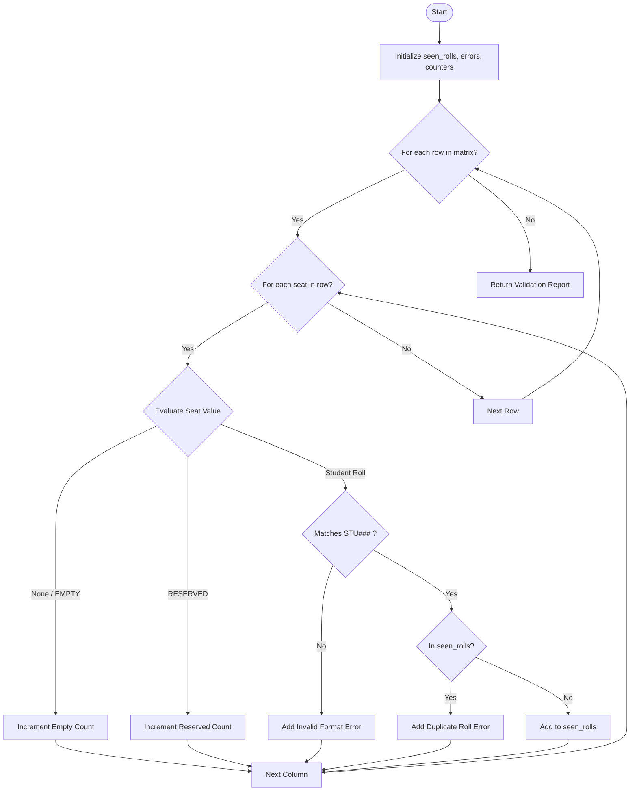

## Problem Statement

Design a robust validation system for an examination hall seating arrangement represented as a 2D list (matrix). The seating matrix contains student roll numbers, empty seats (`"EMPTY"` or `None`), and reserved positions (`"RESERVED"`).

The validation algorithm must inspect the complete matrix and detect:

1. **Duplicate Roll Numbers:** Ensure no student is allocated to more than one seat.
2. **Invalid Allocations / Formats:** Ensure student roll numbers adhere to a standardized format (e.g., `STU` followed by 3 digits).
3. **Reserved Position Integrity:** Track reserved seats and empty seats correctly.
4. **Data Type Errors:** Flag any unexpected entries in the seating grid.

---

## Algorithm

1. Initialize an empty set `seen_rolls` to track unique student roll numbers, an empty list `errors` to record violations, and counters for empty and reserved seats.
2. Define a regular expression pattern for valid student roll numbers (`^STU\d{3}$`).
3. Iterate through each row (`r_idx`) and column (`c_idx`) of the 2D seating matrix:
* **If the seat is `None` or `"EMPTY"`:** Increment the `empty_seats` counter.
* **If the seat is `"RESERVED"`:** Increment the `reserved_seats` counter.
* **If the seat is a string (Student Roll):**
* Check if it matches the valid format. If it does not, append an invalid format error to `errors`.
* Check if the roll number already exists in `seen_rolls`. If it does, append a duplicate roll number error to `errors`.
* Otherwise, add the roll number to `seen_rolls`.


* **Any other type:** Append a data type error to `errors`.


4. Return a dictionary containing the overall validity status, list of errors, and summary metrics.

---

## Flowchart



---

## Python Source Code

```python
import re

def validate_seating(matrix):
    seen_rolls = set()
    errors = []
    empty_count = 0
    reserved_count = 0
    pattern = re.compile(r"^STU\d{3}$")
    
    for r_idx, row in enumerate(matrix):
        for c_idx, seat in enumerate(row):
            if seat is None or seat == "EMPTY":
                empty_count += 1
            elif seat == "RESERVED":
                reserved_count += 1
            elif isinstance(seat, str):
                if not pattern.match(seat):
                    errors.append(f"Invalid format at ({r_idx}, {c_idx}): {seat}")
                elif seat in seen_rolls:
                    errors.append(f"Duplicate roll number at ({r_idx}, {c_idx}): {seat}")
                else:
                    seen_rolls.add(seat)
            else:
                errors.append(f"Invalid data type at ({r_idx}, {c_idx}): {seat}")
                
    return {
        "is_valid": len(errors) == 0,
        "errors": errors,
        "empty_seats": empty_count,
        "reserved_seats": reserved_count,
        "unique_students": len(seen_rolls)
    }

```

---

## Sample Input

```python
seating_matrix = [
    ["STU101", "STU102", "EMPTY", "RESERVED"],
    ["STU103", "BAD123", "STU101", None],
    ["RESERVED", "STU105", "EMPTY", "STU106"]
]

result = validate_seating(seating_matrix)
print(result)

```

---

## Sample Output

```json
{
    "is_valid": false,
    "errors": [
        "Invalid format at (1, 1): BAD123",
        "Duplicate roll number at (1, 2): STU101"
    ],
    "empty_seats": 3,
    "reserved_seats": 2,
    "unique_students": 5
}

```
