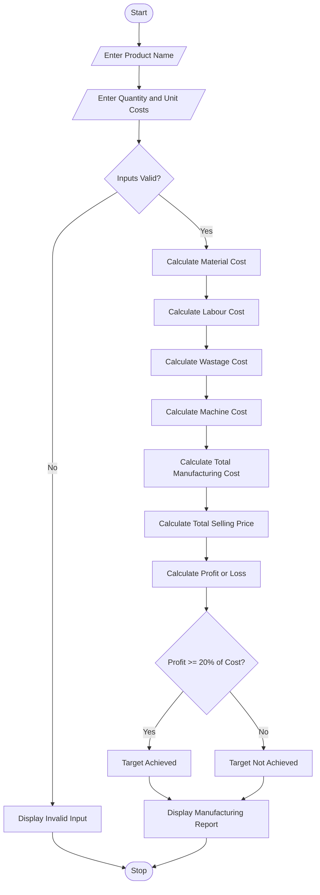

## 1. Problem Statement
 Manufacturing Cost and Profitability Analysis: Calculate material costs, labour charges, wastage, machine costs, and selling prices; identify whether production meets a specified profit target. 

## 2. Algorithm

**Step 1:** Start the program.

**Step 2:** Enter product name.

**Step 3:** Enter production quantity.

**Step 4:** Enter material, labour, machine, and selling costs per unit.

**Step 5:** Calculate total material cost.

**Step 6:** Calculate labour charges.

**Step 7:** Calculate wastage cost.

**Step 8:** Calculate machine operating cost.

**Step 9:** Calculate total manufacturing cost.

**Step 10:** Calculate total selling price.

**Step 11:** Calculate profit or loss.

**Step 12:** Check whether profit meets the 20% target.

**Step 13:** Display the manufacturing cost report.

**Step 14:** Stop the program.

## 3. Flowchart


## 4. Sample Input

```text
MANUFACTURING COST ANALYSIS

Enter Product Name: Chair

Enter Production Quantity: 100

Enter Material Cost per Unit: 100

Enter Labour Cost per Unit: 30

Enter Machine Cost per Unit: 20

Enter Selling Price per Unit: 200
```

## 5. Sample Output

```text
----- MANUFACTURING REPORT -----

Product Name: Chair
Production Quantity: 100

Material Cost: Rs. 10000
Labour Cost: Rs. 3000
Wastage Cost: Rs. 500
Machine Cost: Rs. 2000

--------------------------------

Total Manufacturing Cost: Rs. 15500

Total Selling Price: Rs. 20000

Profit / Loss: Rs. 4500

Profit Percentage: 29.03 %

Result: Profit Target Achieved

--------------------------------
Thank You!
```
