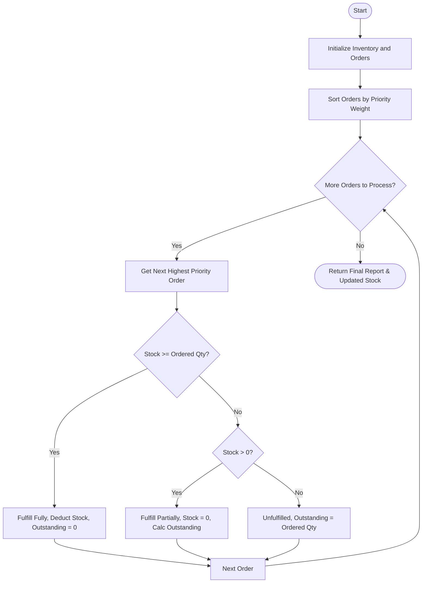

## Problem Statement

Design a warehouse order prioritization and fulfillment system that processes current product stock levels alongside a set of customer orders containing product demands, quantities, and priority categories (e.g., High, Medium, Low). The system must prioritize high-priority orders first, sequentially allocate available inventory, determine whether each order is fully fulfilled, partially fulfilled, or unfulfilled, and calculate any outstanding quantities.

---

## Algorithm

1. Initialize inventory stock levels and a list of customer orders with priority tiers.
2. Assign numerical weights to priority categories (e.g., High = 1, Medium = 2, Low = 3) and sort the orders based on these weights.
3. Iterate through each sorted order:
* Check the available stock for the requested product.
* If available stock is greater than or equal to the ordered quantity, fulfill the order completely, subtract the quantity from stock, set outstanding quantity to 0, and mark as `"Fully Fulfilled"`.
* If available stock is less than the ordered quantity but greater than zero, fulfill as much as possible, deplete the stock to zero, calculate the remaining outstanding quantity, and mark as `"Partially Fulfilled"`.
* If stock is zero, fulfill 0 units, set outstanding quantity equal to the ordered quantity, and mark as `"Unfulfilled"`.


4. Return the updated inventory levels and the comprehensive fulfillment report for all orders.

---

## Flowchart



---

## Python Source Code

```python
def process_warehouse_orders(inventory, orders):
    priority_mapping = {"High": 1, "Medium": 2, "Low": 3}
    sorted_orders = sorted(orders, key=lambda x: priority_mapping.get(x["priority"], 4))
    
    stock = inventory.copy()
    results = []
    
    for order in sorted_orders:
        prod = order["product_id"]
        qty_ordered = order["quantity"]
        available = stock.get(prod, 0)
        
        if available >= qty_ordered:
            stock[prod] -= qty_ordered
            results.append({
                "order_id": order["order_id"],
                "product_id": prod,
                "ordered": qty_ordered,
                "fulfilled": qty_ordered,
                "outstanding": 0,
                "status": "Fully Fulfilled"
            })
        elif available > 0:
            stock[prod] = 0
            results.append({
                "order_id": order["order_id"],
                "product_id": prod,
                "ordered": qty_ordered,
                "fulfilled": available,
                "outstanding": qty_ordered - available,
                "status": "Partially Fulfilled"
            })
        else:
            results.append({
                "order_id": order["order_id"],
                "product_id": prod,
                "ordered": qty_ordered,
                "fulfilled": 0,
                "outstanding": qty_ordered,
                "status": "Unfulfilled"
            })
            
    return {
        "updated_inventory": stock,
        "order_results": results
    }

```

---

## Sample Input

```python
inventory = {
    "PROD_A": 10,
    "PROD_B": 5
}

orders = [
    {"order_id": "ORD-001", "product_id": "PROD_A", "quantity": 8, "priority": "Low"},
    {"order_id": "ORD-002", "product_id": "PROD_A", "quantity": 5, "priority": "High"},
    {"order_id": "ORD-003", "product_id": "PROD_B", "quantity": 6, "priority": "Medium"}
]

result = process_warehouse_orders(inventory, orders)
print(result)

```

---

## Sample Output

```json
{
    "updated_inventory": {
        "PROD_A": 0,
        "PROD_B": 0
    },
    "order_results": [
        {
            "order_id": "ORD-002",
            "product_id": "PROD_A",
            "ordered": 5,
            "fulfilled": 5,
            "outstanding": 0,
            "status": "Fully Fulfilled"
        },
        {
            "order_id": "ORD-003",
            "product_id": "PROD_B",
            "ordered": 6,
            "fulfilled": 5,
            "outstanding": 1,
            "status": "Partially Fulfilled"
        },
        {
            "order_id": "ORD-001",
            "product_id": "PROD_A",
            "ordered": 8,
            "fulfilled": 5,
            "outstanding": 3,
            "status": "Partially Fulfilled"
        }
    ]
}

```
